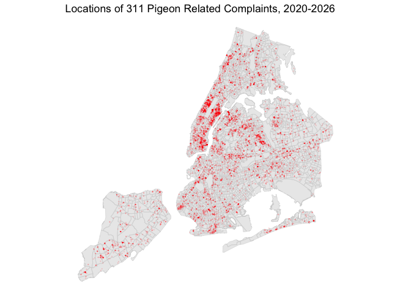
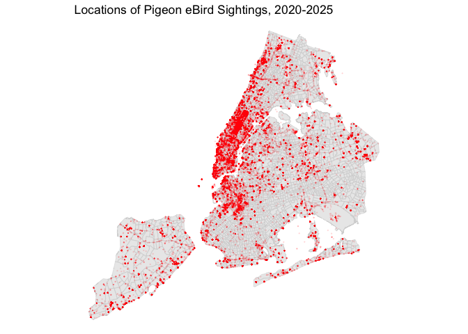
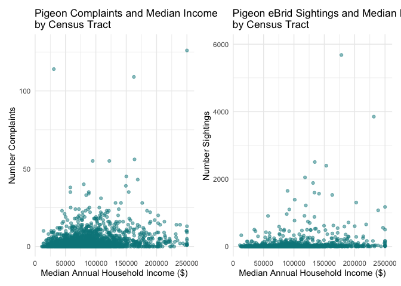
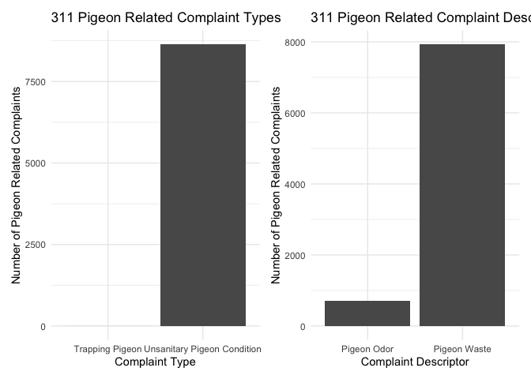
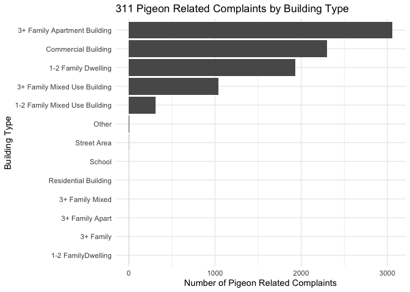

Data Cleaning
================
Everyone
2026-11-17

## Load packages:

``` r
library(tidyverse)
```

    ## Warning: package 'purrr' was built under R version 4.5.2

    ## Warning: package 'dplyr' was built under R version 4.5.2

    ## ── Attaching core tidyverse packages ──────────────────────── tidyverse 2.0.0 ──
    ## ✔ dplyr     1.2.1     ✔ readr     2.1.5
    ## ✔ forcats   1.0.1     ✔ stringr   1.5.1
    ## ✔ ggplot2   4.0.0     ✔ tibble    3.3.0
    ## ✔ lubridate 1.9.4     ✔ tidyr     1.3.1
    ## ✔ purrr     1.2.2     
    ## ── Conflicts ────────────────────────────────────────── tidyverse_conflicts() ──
    ## ✖ dplyr::filter() masks stats::filter()
    ## ✖ dplyr::lag()    masks stats::lag()
    ## ℹ Use the conflicted package (<http://conflicted.r-lib.org/>) to force all conflicts to become errors

``` r
library(tidycensus)
```

    ## Warning: package 'tidycensus' was built under R version 4.5.2

``` r
library(lubridate)
library(sf)
```

    ## Warning: package 'sf' was built under R version 4.5.2

    ## Linking to GEOS 3.14.1, GDAL 3.8.5, PROJ 9.5.1; sf_use_s2() is TRUE

``` r
library(tigris)
```

    ## To enable caching of data, set `options(tigris_use_cache = TRUE)`
    ## in your R script or .Rprofile.

``` r
library(patchwork)
library(scales)
```

    ## 
    ## Attaching package: 'scales'
    ## 
    ## The following object is masked from 'package:purrr':
    ## 
    ##     discard
    ## 
    ## The following object is masked from 'package:readr':
    ## 
    ##     col_factor

## Load and process 311 data:

``` r
pigeon_311_df = read_csv("data/contains_'Pigeon'_20261117.csv") |> 
  janitor::clean_names() |> 
  select(unique_key, created_date, closed_date, problem_formerly_complaint_type, 
problem_detail_formerly_descriptor, location_type, incident_zip, latitude, longitude, borough, status,  
resolution_description, resolution_action_updated_date, location) |> 
  mutate(
    created_date = ymd_hms(created_date),
    closed_date = ymd_hms(closed_date),
    complaint_type = factor(problem_formerly_complaint_type),
    complaint_descriptor = factor(problem_detail_formerly_descriptor),
    location_type = factor(location_type),
    incident_zip = factor(incident_zip),
    borough = factor(borough),
    length_open = difftime(closed_date, created_date, units = "days")
  ) |> 
  select(-contains("problem")) |> 
  relocate(unique_key, created_date, closed_date, length_open, status, location, latitude, longitude, incident_zip, borough, location_type, complaint_type, complaint_descriptor, resolution_description, resolution_action_updated_date) 
```

    ## Rows: 8644 Columns: 30
    ## ── Column specification ────────────────────────────────────────────────────────
    ## Delimiter: ","
    ## chr (23): Created Date, Closed Date, Agency, Agency Name, Problem (formerly ...
    ## dbl  (4): Unique Key, Incident Zip, Latitude, Longitude
    ## num  (2): X Coordinate (State Plane), Y Coordinate (State Plane)
    ## lgl  (1): Due Date
    ## 
    ## ℹ Use `spec()` to retrieve the full column specification for this data.
    ## ℹ Specify the column types or set `show_col_types = FALSE` to quiet this message.

## Import income data:

``` r
## Intialize API key if necessary. Otherwise, keep line commented out:
## census_api_key("f8e602dfbaa32070e224824940f2b356d38db646", overwrite = TRUE, install = TRUE)

## Pull data from 2024:
income_df =
  get_acs(
    geography = "tract",
    variable     = "B19013_001",
    state     = "NY",
    county    = c("Bronx", "Kings", "New York", "Queens", "Richmond"),
    year      = 2024,        
    survey    = "acs5",
    cache_table = TRUE,
    geometry = TRUE) |> 
  st_transform(4326) |> 
  janitor::clean_names() |> 
  select(geoid, geometry, estimate, moe)
```

    ## Getting data from the 2020-2024 5-year ACS

    ## Downloading feature geometry from the Census website.  To cache shapefiles for use in future sessions, set `options(tigris_use_cache = TRUE)`.

    ##   |                                                                              |                                                                      |   0%  |                                                                              |=                                                                     |   1%  |                                                                              |=                                                                     |   2%  |                                                                              |==                                                                    |   3%  |                                                                              |===                                                                   |   4%  |                                                                              |===                                                                   |   5%  |                                                                              |====                                                                  |   5%  |                                                                              |====                                                                  |   6%  |                                                                              |=====                                                                 |   7%  |                                                                              |=====                                                                 |   8%  |                                                                              |======                                                                |   9%  |                                                                              |=======                                                               |  10%  |                                                                              |========                                                              |  11%  |                                                                              |=========                                                             |  12%  |                                                                              |=========                                                             |  13%  |                                                                              |==========                                                            |  14%  |                                                                              |==========                                                            |  15%  |                                                                              |===========                                                           |  16%  |                                                                              |============                                                          |  17%  |                                                                              |=============                                                         |  18%  |                                                                              |=============                                                         |  19%  |                                                                              |==============                                                        |  20%  |                                                                              |===============                                                       |  21%  |                                                                              |================                                                      |  22%  |                                                                              |================                                                      |  23%  |                                                                              |=================                                                     |  24%  |                                                                              |=================                                                     |  25%  |                                                                              |==================                                                    |  26%  |                                                                              |===================                                                   |  27%  |                                                                              |====================                                                  |  28%  |                                                                              |====================                                                  |  29%  |                                                                              |=====================                                                 |  30%  |                                                                              |======================                                                |  31%  |                                                                              |======================                                                |  32%  |                                                                              |=======================                                               |  33%  |                                                                              |========================                                              |  34%  |                                                                              |=========================                                             |  35%  |                                                                              |=========================                                             |  36%  |                                                                              |==========================                                            |  37%  |                                                                              |==========================                                            |  38%  |                                                                              |===========================                                           |  38%  |                                                                              |============================                                          |  39%  |                                                                              |============================                                          |  40%  |                                                                              |=============================                                         |  41%  |                                                                              |=============================                                         |  42%  |                                                                              |==============================                                        |  43%  |                                                                              |===============================                                       |  44%  |                                                                              |================================                                      |  45%  |                                                                              |================================                                      |  46%  |                                                                              |=================================                                     |  47%  |                                                                              |=================================                                     |  48%  |                                                                              |==================================                                    |  49%  |                                                                              |===================================                                   |  50%  |                                                                              |====================================                                  |  51%  |                                                                              |====================================                                  |  52%  |                                                                              |=====================================                                 |  53%  |                                                                              |======================================                                |  54%  |                                                                              |======================================                                |  55%  |                                                                              |=======================================                               |  56%  |                                                                              |========================================                              |  57%  |                                                                              |=========================================                             |  58%  |                                                                              |=========================================                             |  59%  |                                                                              |==========================================                            |  60%  |                                                                              |==========================================                            |  61%  |                                                                              |===========================================                           |  61%  |                                                                              |============================================                          |  62%  |                                                                              |============================================                          |  63%  |                                                                              |=============================================                         |  64%  |                                                                              |=============================================                         |  65%  |                                                                              |==============================================                        |  66%  |                                                                              |===============================================                       |  67%  |                                                                              |================================================                      |  68%  |                                                                              |================================================                      |  69%  |                                                                              |=================================================                     |  70%  |                                                                              |=================================================                     |  71%  |                                                                              |==================================================                    |  71%  |                                                                              |===================================================                   |  72%  |                                                                              |===================================================                   |  73%  |                                                                              |====================================================                  |  74%  |                                                                              |====================================================                  |  75%  |                                                                              |=====================================================                 |  76%  |                                                                              |======================================================                |  77%  |                                                                              |=======================================================               |  78%  |                                                                              |=======================================================               |  79%  |                                                                              |========================================================              |  80%  |                                                                              |=========================================================             |  81%  |                                                                              |=========================================================             |  82%  |                                                                              |==========================================================            |  83%  |                                                                              |===========================================================           |  84%  |                                                                              |============================================================          |  85%  |                                                                              |============================================================          |  86%  |                                                                              |=============================================================         |  87%  |                                                                              |=============================================================         |  88%  |                                                                              |==============================================================        |  88%  |                                                                              |===============================================================       |  89%  |                                                                              |===============================================================       |  90%  |                                                                              |================================================================      |  91%  |                                                                              |================================================================      |  92%  |                                                                              |=================================================================     |  93%  |                                                                              |==================================================================    |  94%  |                                                                              |===================================================================   |  95%  |                                                                              |===================================================================   |  96%  |                                                                              |====================================================================  |  97%  |                                                                              |===================================================================== |  98%  |                                                                              |===================================================================== |  99%  |                                                                              |======================================================================| 100%

## Merge income data with the 311 data:

``` r
## Make a list of sf data:
pigeon_311_sf = pigeon_311_df |> 
  filter(!is.na(longitude)) |> 
  st_as_sf(coords = c("longitude", "latitude"), crs = 4326) |> 
  select(unique_key, geometry)

## Create a merged data frame of unique id's and census data:
pigeon_311_merge =  pigeon_311_sf |> 
  st_join(income_df, left = T)

## Merge with the pigeon df:
pigeon_311_df = pigeon_311_df |> 
  left_join(pigeon_311_merge, by = "unique_key") |> 
  rename(median_inc_est = estimate, median_inc_moe = moe)
```

## Add E-Bird Data:

``` r
## Load and process ebird data:
pigeon_ebird_df = read_csv("data/ebird.csv.zip") |> 
  select(gbifID, occurrenceID, recordedBy, eventDate, individualCount, 
         locality, occurrenceStatus, decimalLatitude, decimalLongitude) |> 
  janitor::clean_names() |> 
  rename(latitude = decimal_latitude, longitude = decimal_longitude) |> 
  mutate(event_date = mdy(event_date)) |> 
  st_as_sf(coords = c("longitude", "latitude"), crs = 4326)
```

    ## Multiple files in zip: reading 'ebird.csv'
    ## Rows: 387975 Columns: 50
    ## ── Column specification ────────────────────────────────────────────────────────
    ## Delimiter: ","
    ## chr  (27): datasetKey, occurrenceID, kingdom, phylum, class, order, family, ...
    ## dbl   (7): gbifID, individualCount, decimalLatitude, decimalLongitude, day, ...
    ## lgl  (15): infraspecificEpithet, verbatimScientificNameAuthorship, coordinat...
    ## dttm  (1): lastInterpreted
    ## 
    ## ℹ Use `spec()` to retrieve the full column specification for this data.
    ## ℹ Specify the column types or set `show_col_types = FALSE` to quiet this message.

``` r
## Load nyc boundary:
nyc <- counties(state = "NY", cb = TRUE) |>
  filter(COUNTYFP %in% c("005", "047", "061", "081", "085")) |>
  st_transform(st_crs(pigeon_ebird_df)) |>
  select(county = NAME)
```

    ## Retrieving data for the year 2024

    ##   |                                                                              |                                                                      |   0%  |                                                                              |                                                                      |   1%  |                                                                              |=                                                                     |   1%  |                                                                              |=                                                                     |   2%  |                                                                              |==                                                                    |   2%  |                                                                              |==                                                                    |   3%  |                                                                              |==                                                                    |   4%  |                                                                              |===                                                                   |   4%  |                                                                              |===                                                                   |   5%  |                                                                              |====                                                                  |   5%  |                                                                              |====                                                                  |   6%  |                                                                              |=====                                                                 |   7%  |                                                                              |=====                                                                 |   8%  |                                                                              |======                                                                |   8%  |                                                                              |======                                                                |   9%  |                                                                              |=======                                                               |   9%  |                                                                              |=======                                                               |  10%  |                                                                              |=======                                                               |  11%  |                                                                              |========                                                              |  11%  |                                                                              |========                                                              |  12%  |                                                                              |=========                                                             |  12%  |                                                                              |=========                                                             |  13%  |                                                                              |=========                                                             |  14%  |                                                                              |==========                                                            |  14%  |                                                                              |==========                                                            |  15%  |                                                                              |===========                                                           |  15%  |                                                                              |===========                                                           |  16%  |                                                                              |============                                                          |  16%  |                                                                              |============                                                          |  17%  |                                                                              |============                                                          |  18%  |                                                                              |=============                                                         |  18%  |                                                                              |=============                                                         |  19%  |                                                                              |==============                                                        |  19%  |                                                                              |==============                                                        |  20%  |                                                                              |==============                                                        |  21%  |                                                                              |===============                                                       |  21%  |                                                                              |===============                                                       |  22%  |                                                                              |================                                                      |  22%  |                                                                              |================                                                      |  23%  |                                                                              |================                                                      |  24%  |                                                                              |=================                                                     |  24%  |                                                                              |=================                                                     |  25%  |                                                                              |==================                                                    |  25%  |                                                                              |==================                                                    |  26%  |                                                                              |===================                                                   |  27%  |                                                                              |===================                                                   |  28%  |                                                                              |====================                                                  |  28%  |                                                                              |====================                                                  |  29%  |                                                                              |=====================                                                 |  29%  |                                                                              |=====================                                                 |  30%  |                                                                              |=====================                                                 |  31%  |                                                                              |======================                                                |  31%  |                                                                              |======================                                                |  32%  |                                                                              |=======================                                               |  32%  |                                                                              |=======================                                               |  33%  |                                                                              |========================                                              |  34%  |                                                                              |========================                                              |  35%  |                                                                              |=========================                                             |  35%  |                                                                              |=========================                                             |  36%  |                                                                              |==========================                                            |  37%  |                                                                              |==========================                                            |  38%  |                                                                              |===========================                                           |  38%  |                                                                              |===========================                                           |  39%  |                                                                              |============================                                          |  39%  |                                                                              |============================                                          |  40%  |                                                                              |============================                                          |  41%  |                                                                              |=============================                                         |  41%  |                                                                              |=============================                                         |  42%  |                                                                              |==============================                                        |  42%  |                                                                              |==============================                                        |  43%  |                                                                              |===============================                                       |  44%  |                                                                              |===============================                                       |  45%  |                                                                              |================================                                      |  45%  |                                                                              |================================                                      |  46%  |                                                                              |=================================                                     |  47%  |                                                                              |=================================                                     |  48%  |                                                                              |==================================                                    |  48%  |                                                                              |==================================                                    |  49%  |                                                                              |===================================                                   |  49%  |                                                                              |===================================                                   |  50%  |                                                                              |===================================                                   |  51%  |                                                                              |====================================                                  |  51%  |                                                                              |====================================                                  |  52%  |                                                                              |=====================================                                 |  52%  |                                                                              |=====================================                                 |  53%  |                                                                              |=====================================                                 |  54%  |                                                                              |======================================                                |  54%  |                                                                              |======================================                                |  55%  |                                                                              |=======================================                               |  55%  |                                                                              |=======================================                               |  56%  |                                                                              |========================================                              |  57%  |                                                                              |========================================                              |  58%  |                                                                              |=========================================                             |  58%  |                                                                              |=========================================                             |  59%  |                                                                              |==========================================                            |  59%  |                                                                              |==========================================                            |  60%  |                                                                              |==========================================                            |  61%  |                                                                              |===========================================                           |  61%  |                                                                              |===========================================                           |  62%  |                                                                              |============================================                          |  62%  |                                                                              |============================================                          |  63%  |                                                                              |=============================================                         |  64%  |                                                                              |=============================================                         |  65%  |                                                                              |==============================================                        |  65%  |                                                                              |==============================================                        |  66%  |                                                                              |===============================================                       |  67%  |                                                                              |===============================================                       |  68%  |                                                                              |================================================                      |  68%  |                                                                              |================================================                      |  69%  |                                                                              |=================================================                     |  69%  |                                                                              |=================================================                     |  70%  |                                                                              |=================================================                     |  71%  |                                                                              |==================================================                    |  71%  |                                                                              |==================================================                    |  72%  |                                                                              |===================================================                   |  72%  |                                                                              |===================================================                   |  73%  |                                                                              |====================================================                  |  74%  |                                                                              |====================================================                  |  75%  |                                                                              |=====================================================                 |  75%  |                                                                              |=====================================================                 |  76%  |                                                                              |======================================================                |  77%  |                                                                              |======================================================                |  78%  |                                                                              |=======================================================               |  78%  |                                                                              |=======================================================               |  79%  |                                                                              |========================================================              |  79%  |                                                                              |========================================================              |  80%  |                                                                              |========================================================              |  81%  |                                                                              |=========================================================             |  81%  |                                                                              |=========================================================             |  82%  |                                                                              |==========================================================            |  82%  |                                                                              |==========================================================            |  83%  |                                                                              |===========================================================           |  84%  |                                                                              |===========================================================           |  85%  |                                                                              |============================================================          |  85%  |                                                                              |============================================================          |  86%  |                                                                              |=============================================================         |  87%  |                                                                              |=============================================================         |  88%  |                                                                              |==============================================================        |  88%  |                                                                              |==============================================================        |  89%  |                                                                              |===============================================================       |  89%  |                                                                              |===============================================================       |  90%  |                                                                              |===============================================================       |  91%  |                                                                              |================================================================      |  91%  |                                                                              |================================================================      |  92%  |                                                                              |=================================================================     |  92%  |                                                                              |=================================================================     |  93%  |                                                                              |==================================================================    |  94%  |                                                                              |==================================================================    |  95%  |                                                                              |===================================================================   |  95%  |                                                                              |===================================================================   |  96%  |                                                                              |====================================================================  |  97%  |                                                                              |====================================================================  |  98%  |                                                                              |===================================================================== |  98%  |                                                                              |===================================================================== |  99%  |                                                                              |======================================================================|  99%  |                                                                              |======================================================================| 100%

``` r
## Subset the ebird data by nyc boundaries:
pigeon_ebird_df <- st_join(pigeon_ebird_df, nyc, left = FALSE) 
```

## Data is loaded and cleaned. Use pigeon_ebird_df for e-bird data and pigeon_311_df for 311 data.

## Next steps:

1.  Create new rmd with final report.
2.  Use API to load pigeon data.
3.  Have rmd with dashboard code.
4.  Visualizations:

- Mapping - GM
- Temporal Trends
- Complaint resolution length.
- Complaint closure randomly dispersed???
  - Local Moran’s I

##### Planned analyses:

1)  Temporal trend of complaints

- 6 years of data - have the amount of complaints changed?

Yearly trends in the number of complaints

``` r
complaints_by_year = 
  pigeon_311_df |> 
  mutate(
    year = year(created_date)
  ) |> 
  count(year, name = "n_reports")

complaints_by_year |> 
  ggplot(aes(x = year, y = n_reports)) +
  geom_line() +
  geom_point() +
  scale_x_continuous() +
  scale_y_continuous() +
  labs(
    title = "311 Pigeon Related Complaints per Year",
    x = "Year",
    y = "Number of Pigeon Related Complaints"
  ) +
  theme_minimal()
```

<!-- --> The
number of pigeon-related 311 complaints steadily increased between 2020
and 2025. 2026 not over yet –\> looks like it plateued but will most
likely still be an increase (albeit a smaller one)

Seasonal trends in the level of complaints, across all years

``` r
seasonal_complaints = 
  pigeon_311_df |> 
  mutate(
    month = month(created_date, label = TRUE, abbr = TRUE)
  ) |> 
  count(month, name = "n_reports")

seasonal_complaints |> 
  ggplot(aes(x = month, y = n_reports, group = 1)) +
  geom_line() +
  geom_point() +
  scale_y_continuous() +
  labs(
    title = "311 Pigeon Related Complaints per Month Across Years",
    x = "Month",
    y = "Number of Pigeon Related Complaints"
  ) +
  theme_minimal()
```

<!-- --> Each
year, the number of 311 pigeon related complaints peaks in late summer
before reaching a low point in December.

2)  Geographical distribution of complaints

Spatial visualization of complaints, ebird sightings, and median
household income

``` r
land_boundary_sf =
  read_csv("data/Modified_Zip_Code_Tabulation_Areas_(MODZCTA)_20260924.csv") |> 
  st_as_sf( wkt = "the_geom", crs = 4326) |> 
  st_make_valid() |> 
  st_union()
```

    ## Rows: 178 Columns: 5
    ## ── Column specification ────────────────────────────────────────────────────────
    ## Delimiter: ","
    ## chr (3): label, ZCTA, the_geom
    ## dbl (1): MODZCTA
    ## num (1): pop_est
    ## 
    ## ℹ Use `spec()` to retrieve the full column specification for this data.
    ## ℹ Specify the column types or set `show_col_types = FALSE` to quiet this message.

``` r
income_df= 
  st_intersection(income_df, land_boundary_sf)
```

    ## Warning: attribute variables are assumed to be spatially constant throughout
    ## all geometries

``` r
#income
ggplot() +
  geom_sf(
    data = income_df,
    aes(fill = estimate),
    color = NA
  ) +
 scale_fill_gradientn(
    name = "($)",
    colors = scales:: brewer_pal(palette = "YlGnBu")(9),
    trans = "sqrt",     
  ) +
  theme_void() +
    labs(
    title = "Median Annual Household Income by Census Tract, 2024",
    caption = "*grey areas represent census tracts for which median household \nincome is not estimated by the ACS due to a small populations")
```

<!-- -->

``` r
#Complaint locations
ggplot()+
    geom_sf(
    data = income_df,
    color="grey84") +
  geom_sf(
    data = pigeon_311_sf, 
    size = 0.1,
    alpha = 0.1,
    color = "red"
  ) +
  theme_void()+
  labs(
    title = "Locations of 311 Pigeon Related Complaints, 2020-2026")
```

<!-- -->

``` r
#ebird sighting locations
ggplot()+
    geom_sf(
    data = income_df,
    color="grey84") +
  geom_sf(
    data = pigeon_ebird_df, 
    size = 0.1,
    alpha = 0.1,
    color = "red"
  ) +
  theme_void()+
  labs(
    title = "Locations of Pigeon eBird Sightings, 2020-2025")
```

<!-- -->

Spatial visualization of number of pigeon complaints and ebird sightings
per census tract \*\*unsure if this step should go in the data cleaning

``` r
pigeon_counts_census_tract =
  income_df |> 
  mutate(
    n_complaints = lengths(st_intersects(income_df, pigeon_311_sf)), 
    n_sightings = lengths(st_intersects(income_df, pigeon_ebird_df))
  ) |> 
  relocate(n_complaints, n_sightings, estimate, moe, geometry) |> 
  st_intersection(land_boundary_sf)
```

    ## Warning: attribute variables are assumed to be spatially constant throughout
    ## all geometries

``` r
#complaints
complaints_census_tract_map=
ggplot() +
  geom_sf(
    data = pigeon_counts_census_tract,
    aes(fill = n_complaints),
    color = NA
  ) +
 scale_fill_gradientn(
    name = "Count",
    colors = scales:: brewer_pal(palette = "YlGnBu")(9),
    trans = "log1p",     
  ) +
  geom_sf(
    data = land_boundary_sf,
    fill = NA,
    color = "grey80"
  ) +
  theme_void() +
    labs(
    title = "Number of Pigeon Related Complaints \nby Census Tract")

#sightings
sightings_census_tract_map =
ggplot() +
  geom_sf(
    data = pigeon_counts_census_tract,
    aes(fill = n_sightings),
    color = NA
  ) +
 scale_fill_gradientn(
    name = "Count",
    colors = scales:: brewer_pal(palette = "YlGnBu")(9),
    trans = "log1p",
    breaks = c(0, 100, 1000, 10000, 40000)
  ) +
  geom_sf(
    data = land_boundary_sf,
    fill = NA,
    color = "grey80"
  ) +
  theme_void() +
    labs(
    title = "Number of eBird Pigeon Sightings \nby Census Tract")

complaints_census_tract_map+sightings_census_tract_map 
```

<!-- -->

Scatterplots to visualize correlation between pigeon complaints, pigeon
sightings, and income

``` r
income_by_complaints =
  pigeon_counts_census_tract |> 
  ggplot(aes(x = estimate, y = n_complaints)) + 
  geom_point(
    color = "turquoise4",
    alpha = 0.5
  ) +
  scale_y_continuous(
    limits = c(0, 130))+
  labs(
    title    = "Pigeon Complaints and Median Income \nby Census Tract",
    x        = "Median Annual Household Income ($)",
    y        = "Number Complaints"
  ) +
  theme_minimal()

income_by_sightings =
  pigeon_counts_census_tract |> 
  ggplot(aes(x = estimate, y = n_sightings)) + 
  geom_point(
    color = "turquoise4",
    alpha = 0.5
  ) +
  scale_y_continuous(
    limits = c(0, 6000))+
  labs(
    title    = "Pigeon eBrid Sightings and Median Income \nby Census Tract",
    x        = "Median Annual Household Income ($)",
    y        = "Number Sightings"
  ) +
  theme_minimal()


income_by_complaints + income_by_sightings
```

    ## Warning: Removed 123 rows containing missing values or values outside the scale range
    ## (`geom_point()`).
    ## Removed 123 rows containing missing values or values outside the scale range
    ## (`geom_point()`).

<!-- -->

``` r
#can also create density plots for this 
```

- By borough and neighborhood (incorporate income)
- Temporal trends of pigeon complaints by borough

3)  Type and details of complaints

- Problem: Unsanitary pigeon condition versus trapping pigeon
- Problem detail: Pigeon waste versus pigeon odor

``` r
complaint_type_plot = 
  pigeon_311_df |> 
  count(complaint_type, name = "n_reports") |> 
  ggplot(aes(x = complaint_type, y = n_reports)) +
  geom_col() +
  labs(
    title = "311 Pigeon Related Complaint Types",
    x = "Complaint Type",
    y = "Number of Pigeon Related Complaints"
  ) +
  theme_minimal()

complaint_descriptor_plot = 
  pigeon_311_df |> 
  filter(!is.na(complaint_descriptor), complaint_descriptor != "N/A") |>
  count(complaint_descriptor, name = "n_reports") |> 
  ggplot(aes(x = complaint_descriptor, y = n_reports)) +
  geom_col() +
  labs(
    title = "311 Pigeon Related Complaint Descriptors",
    x = "Complaint Descriptor",
    y = "Number of Pigeon Related Complaints"
  ) +
  theme_minimal()

complaint_type_plot + complaint_descriptor_plot
```

<!-- --> I can
make all of these plots more attractive once we commit to including
them!!

4)  Pigeon complaint by building type

- Residential building versus commercial building versus school versus
  street area, etc.

``` r
pigeon_311_df |> 
  count(location_type, name = "n_reports") |> 
  mutate(location_type = fct_reorder(location_type, n_reports)) |>
  ggplot(aes(x = location_type, y = n_reports)) +
  geom_col() +
  coord_flip() +
  scale_y_continuous() +
  labs(
    title = "311 Pigeon Related Complaints by Building Type",
    x = "Building Type",
    y = "Number of Pigeon Related Complaints"
  ) +
  theme_minimal()
```

<!-- --> Note:
we should probably combine some of these categories (ie. 1-2
FamilyDwelling with 1-2 Family Dwelling)

5)  Brief scientific overview of pigeon species in NYC (EJ)

6)  Are there correlations between where pigeon sightings are reported
    on eBird and where people file pigeon complaints?

7)  Use the API and have a dashboard of complaint monitoring

8)  How long it takes for a 311 Pigeon call to get resolved

- Overall and by geography (incorporate income)
